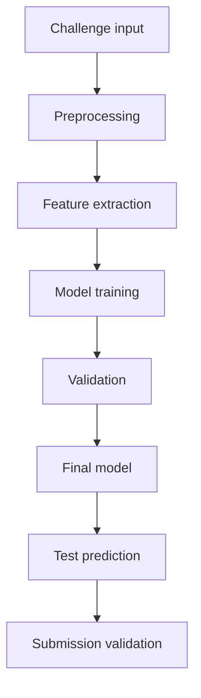

# 📝 Smart Product Pricing Challenge: Technical Solution Report

> Complete this report only after running and validating your actual solution. Replace every placeholder. Do not invent metrics, model capabilities, data sources, or leaderboard results.

## 👥 Team information

- **Team name:** [Team name]
- **Team members:** [Full names and roles]
- **Submission date:** [YYYY-MM-DD]
- **Code repository:** [Repository URL]
- **Code revision:** [Git commit SHA]
- **Experiment ID:** [ID from EXPERIMENTS.md]

---

## 1. 🎯 Executive summary

Describe the problem, the approach actually implemented, the strongest verified validation result, and the main limitation. Keep this factual and concise.

## 2. 🧩 Problem definition

### 2.1 Task
Explain the input fields, target variable, expected output schema, and evaluation metric.

### 2.2 Challenge constraints
- Confirm that external price lookup and price scraping were not used.
- Describe permitted data modalities used.
- Identify model licensing and parameter restrictions that apply.
- List any assumptions or exclusions.

## 3. 📊 Data understanding

### 3.1 Data schema
| Field | Meaning | Used by solution? |
| --- | --- | --- |
| `sample_id` | Sample identifier | [Yes/No, explain] |
| `catalog_content` | Product catalog text | [Yes/No, explain] |
| `image_link` | Image URL | [Yes/No, explain] |
| `price` | Training target | [Training only] |

### 3.2 Data quality and exploration
Report actual row counts, missing values, duplicates, target distribution, text length patterns, and any train/validation overlap checks. Include the script or notebook cell used to calculate them.

### 3.3 Data governance
Describe provenance, permitted usage, storage, and any limitations in the source terms. Do not imply that challenge data or linked images are covered by this repository's MIT license.

## 4. 🧹 Preprocessing and feature engineering

### 4.1 Text pipeline
Document normalization, tokenization, vectorizer type, vocabulary limits, and how transformations are fitted on training folds.

### 4.2 Structured features
Explain quantity, mass, volume, and other extracted features. Describe ambiguous or failed parsing behavior.

### 4.3 Image pipeline
If images are not used, state that clearly. If used, document source permissions, preprocessing, missing-image strategy, model/license, and parameter count.

## 5. 🧠 Model architecture

Describe the model actually trained, target transformation, loss/objective, hyperparameters, and inference procedure.

### 5.1 Architecture flow

Replace this conceptual diagram if the implemented pipeline differs.

### 5.2 Model selection
Explain candidate models, tuning method, stopping criteria, and why the final candidate was selected.

## 6. 🧪 Experimental methodology

- **Validation strategy:** [Holdout / K-fold / Group split]
- **Random seed:** [Seed]
- **Train/validation sizes:** [Measured counts]
- **Leakage controls:** [Describe]
- **Environment:** [Python and package versions]
- **Hardware:** [CPU/GPU/RAM]

Include enough detail for another contributor to reproduce the split and training run.

## 7. 📏 Results and error analysis

### 7.1 Verified validation metrics
| Model | Feature set | Validation split | SMAPE | Runtime | Notes |
| --- | --- | --- | --- | --- | --- |
| [Name] | [Features] | [Split ID] | [Measured result] | [Time] | [Notes] |

Do not include training metrics in the validation column. If no completed validation result exists, state that no verified score is available.

### 7.2 Error analysis
Discuss residual patterns, price bands, product types, parsing failures, and examples selected without using external price lookup.

## 8. 📤 Submission validation

Document output filename, exact columns, row count, ID uniqueness and coverage, missing values, finite/positive prediction checks, and read-back validation.

## 9. ⚠️ Limitations and risks

List known weaknesses, unsupported use cases, data limitations, compute constraints, reproducibility gaps, and potential failure modes.

## 10. 🔐 Fair-play and licensing declaration

Confirm that no prohibited external price lookup, price scraping, or unauthorized labels were used. Identify third-party package/model licenses and any dataset/image terms that apply.

## 11. 🚀 Conclusion and future work

Summarize what was actually achieved. Separate completed work from proposed improvements.

## Appendix A. 🔁 Reproduction instructions

Provide clone/setup commands, dependency installation, notebook or script entry point, and the exact command to reproduce the reported result.

## Appendix B. 📦 Artifacts

List model files, configuration, experiment logs, output checksums, and any permitted supplementary material. Do not commit large generated artifacts or restricted data merely to satisfy this section.
