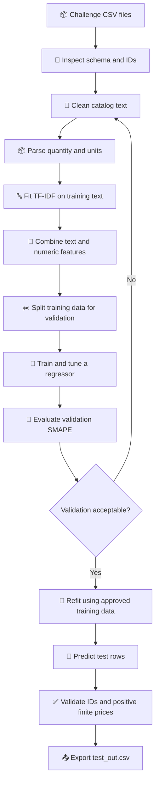

# 🛍️ AmazonML Hackathon | Smart Product Pricing

<p align="center">
  <strong>Machine Learning • NLP • Product Understanding • Regression</strong>
</p>

<p align="center">
  <a href="https://github.com/Brajesh31/AmazonML-Hackathon/actions/workflows/docs.yml"></a>
  
  
  
  
</p>

> A research workspace for the Smart Product Pricing challenge. The objective is to estimate product prices from catalog text and product metadata, using only the challenge-provided training data and following the challenge's strict fair-play rules.

## 🧭 Table of contents

- [🎯 Challenge overview](#-challenge-overview)
- [🧩 Problem contract](#-problem-contract)
- [🧠 Current approach in the notebook](#-current-approach-in-the-notebook)
- [🔄 End-to-end workflow](#-end-to-end-workflow)
- [📁 Repository structure](#-repository-structure)
- [⚙️ Environment setup](#️-environment-setup)
- [▶️ Working with the notebook](#️-working-with-the-notebook)
- [📤 Submission validation](#-submission-validation)
- [📏 Evaluation metric](#-evaluation-metric)
- [🚦 Challenge integrity](#-challenge-integrity)
- [⚠️ Known limitations](#️-known-limitations)
- [📚 Documentation](#-documentation)
- [🤝 Contributing](#-contributing)
- [📄 License and data terms](#-license-and-data-terms)

## 🎯 Challenge overview

The challenge asks participants to predict a product's price from its catalog description and related metadata. The supplied schema is:

| Field | Meaning | Availability |
| --- | --- | --- |
| `sample_id` | Unique row identifier | Train and test |
| `catalog_content` | Product title, description, and item-pack information | Train and test |
| `image_link` | Product image URL | Train and test |
| `price` | Target price | Train only |

The repository's README challenge brief describes roughly 75,000 labeled training rows and 75,000 unlabeled test rows. Confirm actual row counts from the files before reporting experiment statistics.

## 🧩 Problem contract

The submission must contain exactly two columns:

```csv
sample_id,price
```

Every test identifier must occur exactly once. Each prediction must be a finite, positive numeric value. The challenge brief specifies Symmetric Mean Absolute Percentage Error (SMAPE) as the evaluation metric.

## 🧠 Current approach in the notebook

`AmazonML.ipynb` contains an experimental tabular/text pipeline:

- 🧹 Basic text normalization: lowercase conversion, punctuation removal, and whitespace normalization.
- 📦 Quantity extraction: a regular-expression heuristic that extracts a numeric token.
- ⚖️ Weight/volume extraction: a first-match parser for selected units (`kg`, `g`, `l`, `ml`, `oz`).
- 🔤 Text representation: word-level TF-IDF with up to 5,000 features and unigrams/bigrams.
- 🧮 Structured features: quantity and normalized weight/volume values.
- 🌲 Regressor experiments: LightGBM is imported and instantiated; Ridge is imported but the checked-in notebook does not establish a completed Ridge experiment.

The notebook includes a log-target transformation with `log1p`. Its recorded execution contains a LightGBM `TypeError` for the `early_stopping_rounds` fit argument. Do not treat the notebook as a clean, fully reproducible run.

`sample_code.py` is only a format demonstration. It emits random values and is **not a trained prediction model**.

## 🔄 End-to-end workflow



This is the intended experiment lifecycle, not a claim that every stage currently runs end to end without modification.

## 📁 Repository structure

```text
AmazonML-Hackathon/
├── 📓 AmazonML.ipynb                 # Main exploratory/modeling notebook
├── 🐍 sample_code.py                 # Random output-format demonstration
├── 📂 src/
│   └── utils.py                      # Optional image-download helpers
├── 📂 dataset/
│   ├── train.csv                     # Labeled training data
│   ├── test.csv                      # Unlabeled test data
│   ├── sample_test.csv               # Small input-format example
│   └── sample_test_out.csv           # Expected output schema example
├── 📂 docs/                          # Technical documentation
├── 📂 .github/
│   ├── ISSUE_TEMPLATE/               # Issue forms
│   └── workflows/                    # Repository checks
├── 📄 Documentation_template.md      # Challenge methodology template
├── 📄 CONTRIBUTING.md
├── 📄 CODE_OF_CONDUCT.md
├── 📄 SECURITY.md
├── 📄 SUPPORT.md
├── 📄 CHANGELOG.md
├── 📄 ROADMAP.md
├── 📄 CITATION.cff
└── 📄 LICENSE
```

> Large CSVs and temporary artifacts are intentionally not expanded in this overview. Notebook checkpoints and bytecode in the historical tree are generated files, not project modules.

## ⚙️ Environment setup

### Requirements

- Python 3.10 or newer is the documented target for this guide.
- Git and a local clone of this repository.
- Sufficient disk space and memory for the supplied CSV files and sparse feature matrices.

### Create an environment

```bash
git clone https://github.com/Brajesh31/AmazonML-Hackathon.git
cd AmazonML-Hackathon

python -m venv .venv
```

Activate it:

```bash
# Windows PowerShell
.venv\Scripts\Activate.ps1

# Windows Command Prompt
.venv\Scripts\activate.bat

# macOS / Linux
source .venv/bin/activate
```

Install the notebook libraries:

```bash
python -m pip install --upgrade pip
python -m pip install pandas numpy scikit-learn scipy lightgbm tqdm requests jupyter
```

These commands reflect the libraries imported or described in the repository. A pinned, tested lockfile is not currently provided.

## ▶️ Working with the notebook

Launch Jupyter from the repository root:

```bash
jupyter lab
```

Open `AmazonML.ipynb`. Before running it, replace the machine-specific absolute path in its dataset-loading cell with repository-relative paths, for example:

```python
from pathlib import Path
import pandas as pd

DATASET_DIR = Path("dataset")
train_df = pd.read_csv(DATASET_DIR / "train.csv")
test_df = pd.read_csv(DATASET_DIR / "test.csv")
```

Do not claim reproducibility from old notebook outputs alone. Restart the kernel and execute the notebook in order after resolving dependency and path issues.

## 📤 Submission validation

Before uploading a result, verify all of the following:

- [ ] The file is named as required by the challenge portal, usually `test_out.csv`.
- [ ] Columns are exactly `sample_id` and `price`, in that order.
- [ ] The number of output rows equals the number of test rows.
- [ ] All test IDs are present exactly once.
- [ ] No unexpected IDs, nulls, NaN, or infinite values exist.
- [ ] Every price is strictly positive.
- [ ] The file can be read back using pandas.
- [ ] The one-page methodology description matches the actual code and model.
- [ ] No prohibited external price information was used.

Example schema check:

```python
from pathlib import Path
import numpy as np
import pandas as pd

test = pd.read_csv(Path("dataset") / "test.csv")
submission = pd.read_csv("test_out.csv")

assert list(submission.columns) == ["sample_id", "price"]
assert len(submission) == len(test)
assert submission["sample_id"].is_unique
assert set(submission["sample_id"]) == set(test["sample_id"])
assert np.isfinite(submission["price"]).all()
assert (submission["price"] > 0).all()
```

## 📏 Evaluation metric

The challenge brief defines SMAPE as:

```text
SMAPE = mean( |prediction - actual| / ((|actual| + |prediction|) / 2) ) × 100
```

Lower is better. The metric can reach 200%. Define and document the zero-denominator behavior in any local evaluator. Use validation labels from the training set only. Do not use the hidden test set to tune model decisions.

## 🚦 Challenge integrity

The challenge brief explicitly prohibits external price lookup. Do not:

- Scrape product prices from retail sites.
- Call pricing APIs or query external price databases.
- Manually look up current prices for training or test products.
- Add external labels or price-derived features.

Image URLs are a separate input modality mentioned in the challenge brief. Only access images when permitted by the challenge rules and applicable source terms. Never use image downloading to obtain product prices or bypass access restrictions. Model and pretrained-model licensing and parameter limits must comply with the challenge specification.

## ⚠️ Known limitations

| Area | Current limitation | Practical consequence |
| --- | --- | --- |
| Data paths | Notebook contains a developer-specific Windows path | It fails on other machines until corrected |
| LightGBM | Stored output shows unsupported `early_stopping_rounds` argument | Re-run with a compatible callback/API |
| Feature parsing | Quantity regex takes the last integer; unit parser takes only first match | Pack-size and unit interpretation can be wrong |
| Text cleaning | Removes non-ASCII characters and punctuation | May discard useful symbols or multilingual information |
| Validation | Notebook uses a random split and stored outputs are not a clean run record | Validation methodology needs to be formalized |
| Baseline script | Produces random prices | Not useful for meaningful model quality |
| Image helper | Uses 100 workers without retries or throttling controls | High request pressure and unstable downloads |
| Dependencies | No pinned environment specification | Results may vary across installations |
| Tests | No automated model or submission tests are currently defined | Regressions can go unnoticed |

## 📚 Documentation

| Guide | What it covers |
| --- | --- |
| [📖 Documentation index](docs/README.md) | Complete guide map |
| [🏗️ Architecture](docs/architecture.md) | Components and pipeline |
| [🧪 Methodology](docs/methodology.md) | Modeling and validation protocol |
| [📊 Data dictionary](docs/data.md) | Data fields, checks, leakage |
| [🧰 Feature engineering](docs/features.md) | Text and numeric features |
| [📏 Evaluation](docs/evaluation.md) | SMAPE and validation |
| [🔁 Reproducibility](docs/reproducibility.md) | Seeds, versions, artifacts |
| [📤 Submission](docs/submission.md) | Export and schema checks |
| [⚙️ Installation](docs/installation.md) | Local environment |
| [🧑‍💻 Development](docs/development.md) | Engineering conventions |
| [🌐 Image inputs](docs/image-data.md) | Image handling and fair use |
| [🛡️ Security and integrity](SECURITY.md) | Secrets, data protection, rules |
| [🧯 Troubleshooting](docs/troubleshooting.md) | Known failures |
| [❓ FAQ](docs/faq.md) | Common questions |

## 🤝 Contributing

Read [CONTRIBUTING.md](CONTRIBUTING.md) and [CODE_OF_CONDUCT.md](CODE_OF_CONDUCT.md). Contributions should improve correctness, reproducibility, performance, or documentation without violating the challenge rules.

## 📄 License and data terms

Project-authored code and documentation are licensed under MIT as described in [LICENSE](LICENSE). This does not relicense challenge datasets, source images, third-party libraries, pretrained models, or other external assets. Confirm their separate terms before use.

Last updated: 2026-11-16 05:21 UTC
