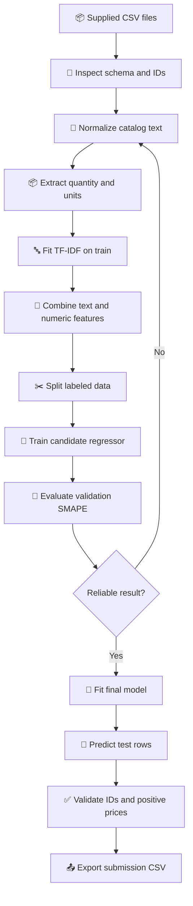

# 🛍️ AmazonML Hackathon | Smart Product Pricing

<p align="center"><strong>Machine Learning • NLP • Product Understanding • Regression</strong></p>

<p align="center">
  <a href="https://github.com/Brajesh31/AmazonML-Hackathon/actions/workflows/docs.yml"></a>
  
  
  
  
</p>

> A notebook-led research workspace for the Smart Product Pricing challenge. Predict product prices from supplied catalog information while respecting the competition's strict fair-play rules.

## 🧭 Contents

- [🎯 Challenge](#-challenge)
- [🧩 Data contract](#-data-contract)
- [🧠 Existing modeling approach](#-existing-modeling-approach)
- [🔄 Workflow](#-workflow)
- [📁 Repository structure](#-repository-structure)
- [⚙️ Setup](#️-setup)
- [▶️ Run the notebook](#️-run-the-notebook)
- [📤 Submission validation](#-submission-validation)
- [📏 Evaluation](#-evaluation)
- [🚦 Integrity rules](#-integrity-rules)
- [⚠️ Known limitations](#️-known-limitations)
- [📚 Documentation](#-documentation)

## 🎯 Challenge

The objective is to estimate a product's price from the provided product catalog content and metadata. The challenge brief describes approximately 75,000 labeled training records and 75,000 unlabeled test records. Verify actual row counts before publishing statistics.

## 🧩 Data contract

| Field | Train | Test | Meaning |
| --- | --- | --- | --- |
| `sample_id` | ✓ | ✓ | Unique sample identifier |
| `catalog_content` | ✓ | ✓ | Product title, description, item-pack information |
| `image_link` | ✓ | ✓ | Product image URL |
| `price` | ✓ | ✗ | Target price |

Submission schema:

```csv
sample_id,price
```

Every test ID must appear exactly once with a finite, positive numeric prediction.

## 🧠 Existing modeling approach

The checked-in `AmazonML.ipynb` contains an experimental text/tabular workflow:

- 🧹 Lowercase and normalize catalog text.
- 📦 Extract a quantity feature using a numeric-token heuristic.
- ⚖️ Parse the first recognized mass/volume token into a numeric feature.
- 🔤 Build word-level TF-IDF features with up to 5,000 terms and unigram/bigram range.
- 🧮 Combine sparse text features with quantity and weight/volume features.
- 🌲 Attempt LightGBM regression using a log-transformed target.

Ridge is imported but the notebook does not establish a completed Ridge experiment. The saved notebook output contains a LightGBM `TypeError` for the supplied `early_stopping_rounds` argument. Do not treat the stored notebook as a clean, fully reproducible run.

**Important:** `sample_code.py` returns random prices. It is only an output-format demonstration, not a trained model.

## 🔄 End-to-end workflow



This is the intended experiment lifecycle, not a claim that every stage currently runs end to end without modification.

## 📁 Repository structure

```text
AmazonML-Hackathon/
├── 📓 AmazonML.ipynb
├── 🐍 sample_code.py
├── 📂 src/
│   └── utils.py
├── 📂 dataset/
│   ├── train.csv
│   ├── test.csv
│   ├── sample_test.csv
│   └── sample_test_out.csv
├── 📂 docs/                    # Technical handbook
├── 📂 .github/
│   ├── ISSUE_TEMPLATE/
│   └── workflows/
├── 📄 Documentation_template.md
├── 📄 CONTRIBUTING.md
├── 📄 CODE_OF_CONDUCT.md
├── 📄 SECURITY.md
├── 📄 SUPPORT.md
├── 📄 CHANGELOG.md
├── 📄 ROADMAP.md
├── 📄 CITATION.cff
└── 📄 LICENSE
```

Historical notebook checkpoints, bytecode, and generated outputs are not source modules.

## ⚙️ Setup

Requirements: Python 3.10+ recommended, Git, local challenge data, and enough memory/disk for feature matrices.

```bash
git clone https://github.com/Brajesh31/AmazonML-Hackathon.git
cd AmazonML-Hackathon
python -m venv .venv
```

Activate:

```bash
# Windows PowerShell
.venv\Scripts\Activate.ps1

# Windows CMD
.venv\Scripts\activate.bat

# macOS / Linux
source .venv/bin/activate
```

Install the libraries referenced by the notebook:

```bash
python -m pip install --upgrade pip
python -m pip install pandas numpy scikit-learn scipy lightgbm tqdm requests jupyter
```

A pinned dependency lockfile is not currently provided.

## ▶️ Run the notebook

```bash
jupyter lab
```

Open `AmazonML.ipynb` from the repository root. The notebook currently contains a developer-specific Windows path. Replace it before running:

```python
from pathlib import Path
import pandas as pd

DATASET_DIR = Path("dataset")
train_df = pd.read_csv(DATASET_DIR / "train.csv")
test_df = pd.read_csv(DATASET_DIR / "test.csv")
```

Restart the kernel and execute cells in order after resolving the LightGBM compatibility issue described in [troubleshooting](docs/troubleshooting.md).

## 📤 Submission validation

Before upload:

- [ ] Columns are exactly `sample_id` and `price`, in that order.
- [ ] Output row count matches `dataset/test.csv`.
- [ ] Every test ID appears exactly once.
- [ ] No missing, unexpected, or duplicate IDs.
- [ ] Prices are finite numeric values and strictly positive.
- [ ] The CSV can be read back.
- [ ] The methodology document matches the actual implementation.
- [ ] No prohibited external price information was used.

Example:

```python
import numpy as np
import pandas as pd

test = pd.read_csv("dataset/test.csv")
submission = pd.read_csv("test_out.csv")
assert list(submission.columns) == ["sample_id", "price"]
assert len(submission) == len(test)
assert submission["sample_id"].is_unique
assert set(submission["sample_id"]) == set(test["sample_id"])
prices = pd.to_numeric(submission["price"], errors="coerce")
assert np.isfinite(prices).all() and (prices > 0).all()
```

## 📏 Evaluation

The challenge uses Symmetric Mean Absolute Percentage Error:

```text
SMAPE = mean(2 * abs(prediction - actual) /
             (abs(actual) + abs(prediction))) * 100
```

Lower is better. The stated range is 0% to 200%. The challenge brief does not define the local convention when both actual and predicted values are zero, so document the convention used by any local evaluator.

## 🚦 Integrity rules

External price lookup is explicitly prohibited. Do not scrape product prices, call pricing APIs, query external price databases, or manually research prices online. Use only challenge-provided labels. Image URLs may only be accessed where permitted, and never to obtain prices or bypass access controls. Respect model license and parameter limits.

## ⚠️ Known limitations

| Area | Observed issue | Impact |
| --- | --- | --- |
| Notebook path | Machine-specific absolute Windows path | Not portable |
| LightGBM | Stored output shows unsupported `early_stopping_rounds` fit argument | Notebook needs compatibility fix |
| Quantity parser | Uses last integer-like token | May misread model numbers or dimensions |
| Unit parser | Uses first matched unit; merges mass and volume | Ambiguous feature semantics |
| Text cleanup | Removes non-ASCII characters | Can discard useful text |
| Validation | Random split appears in notebook; no standardized run record | Comparisons need formalization |
| Baseline | Random price generation | Not a meaningful model |
| Image helper | 100 workers, no explicit retry/backoff | Throttling and incomplete downloads |
| Dependencies | No pinned lockfile | Environment drift |
| Tests | No model/submission test suite found | Regressions may go unnoticed |

## 📚 Documentation

| Guide | Purpose |
| --- | --- |
| [📖 Documentation index](docs/README.md) | Guide map |
| [🏗️ Architecture](docs/architecture.md) | Components and data flow |
| [🧪 Methodology](docs/methodology.md) | Modeling and experiment protocol |
| [📊 Data](docs/data.md) | Data schema and governance |
| [🧰 Features](docs/features.md) | Text, quantity, unit, and image features |
| [📏 Evaluation](docs/evaluation.md) | SMAPE and validation |
| [🔁 Reproducibility](docs/reproducibility.md) | Seeds, versions, artifacts |
| [📤 Submission](docs/submission.md) | Output validation |
| [⚙️ Installation](docs/installation.md) | Environment setup |
| [🧑‍💻 Development](docs/development.md) | Contribution workflow |
| [🖼️ Image data](docs/image-data.md) | Permitted image handling |
| [🔌 Local interfaces](docs/api.md) | Python helpers |
| [🗃️ Storage model](docs/database.md) | CSV schema, no DB service |
| [🚀 Execution](docs/deployment.md) | Competition lifecycle |
| [🧯 Troubleshooting](docs/troubleshooting.md) | Known issues |
| [❓ FAQ](docs/faq.md) | Common questions |

## 🤝 Contributing and support

Read [CONTRIBUTING.md](CONTRIBUTING.md), [CODE_OF_CONDUCT.md](CODE_OF_CONDUCT.md), [SECURITY.md](SECURITY.md), and [SUPPORT.md](SUPPORT.md). Changes should improve correctness and reproducibility without violating challenge integrity.

## 📄 License and data terms

Project-authored code and documentation are licensed under MIT as described in [LICENSE](LICENSE). This does not relicense challenge datasets, external images, libraries, or pretrained models. Verify separate terms before use.

Last updated: 2026-11-16 05:26 UTC
