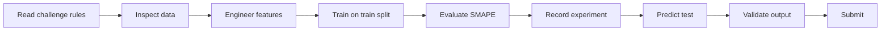

# 📚 Documentation hub

This handbook describes the actual repository and the recommended research workflow. Start with the [project overview](../README.md).

## 🧭 Recommended reading order
1. [⚙️ Installation](installation.md)
2. [📊 Data documentation](data.md)
3. [🏗️ Architecture](architecture.md)
4. [🧪 Methodology](methodology.md)
5. [🧰 Feature engineering](features.md)
6. [📏 Evaluation](evaluation.md)
7. [🔁 Reproducibility](reproducibility.md)
8. [📤 Submission](submission.md)

## 🗺️ Complete guide map
| Guide | Coverage |
| --- | --- |
| [🏗️ Architecture](architecture.md) | Components and data flow |
| [⚙️ Installation](installation.md) | Environment and notebook setup |
| [🧑‍💻 Development](development.md) | Code and experiment workflow |
| [🧪 Methodology](methodology.md) | Model experimentation |
| [🧰 Features](features.md) | Text and numeric features |
| [📊 Data](data.md) | Schema, quality, leakage |
| [🖼️ Image data](image-data.md) | Responsible image handling |
| [📏 Evaluation](evaluation.md) | SMAPE and validation |
| [🔁 Reproducibility](reproducibility.md) | Experiment records |
| [📤 Submission](submission.md) | CSV validation |
| [🔌 Local interfaces](api.md) | Python helpers, no HTTP API |
| [🗃️ Storage](database.md) | CSV model, no database |
| [🚀 Execution](deployment.md) | Local run and portal upload |
| [🧯 Troubleshooting](troubleshooting.md) | Known issues |
| [❓ FAQ](faq.md) | Common questions |

## 🔄 Research lifecycle

## ⚠️ Documentation standard
An import, TODO, or notebook output is not proof that a feature is complete. These docs distinguish existing code from suggestions and known gaps. No score or production capability is claimed without reproducible evidence.
