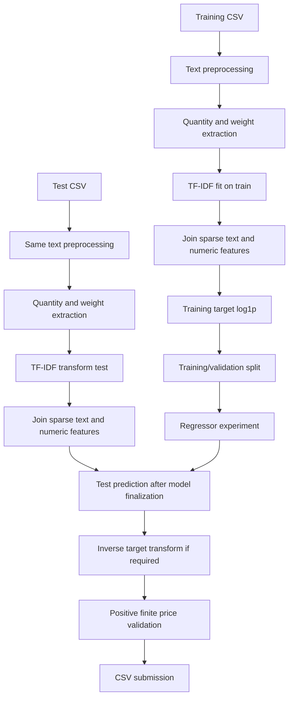

# 🏗️ Architecture and component map

## 🎯 System purpose

The repository organizes a competition workflow for predicting product price from provided catalog content and associated metadata. The current implementation is notebook-led. It does not expose an application server, HTTP endpoint, database, or hosted inference service.

## 🧱 Components

| Component | Responsibility | Current state |
| --- | --- | --- |
| `dataset/train.csv` | Labeled examples | Supplied input |
| `dataset/test.csv` | Unlabeled challenge rows | Supplied input |
| `AmazonML.ipynb` | Exploratory preprocessing and model experiments | Contains a machine-specific path and a recorded LightGBM fit error |
| `src/utils.py` | Optional image download helpers | Uses a 100-process pool without retry/backoff controls |
| `sample_code.py` | Output-format demonstration | Random predictions only |
| `Documentation_template.md` | Methodology submission template | Challenge support file |
| `docs/` | Engineering and research guidance | Documentation |

## 🔄 Notebook pipeline

This diagram describes the conceptual flow represented in notebook cells, not a verified production pipeline. In particular, the notebook's stored LightGBM fit output contains a TypeError and the notebook does not define a clean export-and-validation stage.

## 🧠 Feature representation

The notebook constructs word-level TF-IDF features from cleaned catalog text and appends two numeric features: parsed quantity and parsed weight/volume. The configured vectorizer uses a maximum of 5,000 features, English stop words, and unigram/bigram terms.

## 🚫 Explicit non-components

There is currently no database, API, frontend, scheduler, model registry, experiment tracker, automated deployment, or tested inference package. Do not describe these as implemented capabilities.
