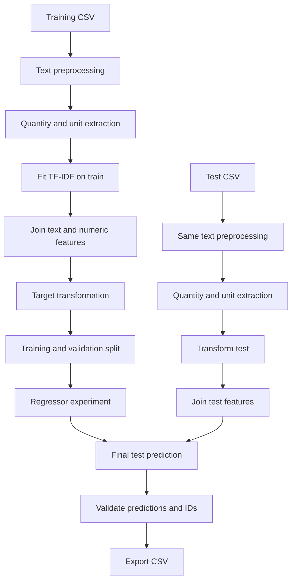

# 🏗️ Architecture and component map

## 🎯 System purpose
This repository is a notebook-led competition workspace for predicting product prices from supplied catalog content and metadata. It is not a deployed application or hosted inference service.

## 🧱 Components
| Component | Responsibility | Current state |
| --- | --- | --- |
| `dataset/train.csv` | Labeled examples | Supplied input |
| `dataset/test.csv` | Unlabeled challenge rows | Supplied input |
| `AmazonML.ipynb` | Exploratory preprocessing/modeling | Contains a machine-specific path and saved LightGBM fit error |
| `src/utils.py` | Optional image download helpers | Uses a 100-process pool without retry/backoff controls |
| `sample_code.py` | Output-format demonstration | Generates random predictions |
| `Documentation_template.md` | Methodology submission template | Challenge support file |
| `docs/` | Engineering and research guidance | Documentation |

## 🔄 Notebook pipeline

This is a conceptual workflow, not a verified successful run. The saved notebook output contains a LightGBM TypeError and no complete submission validation stage.

## 🧠 Feature representation
The notebook uses word-level TF-IDF with a 5,000-feature cap, English stop words, and unigram/bigram terms, plus parsed quantity and weight/volume values.

## 🚫 Explicit non-components
There is no database, HTTP API, frontend, scheduler, model registry, experiment tracker, automated deployment, or tested inference package.
