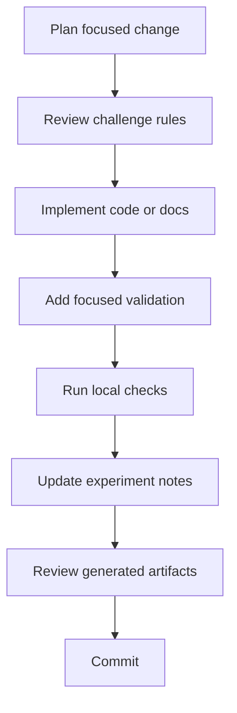

# 🧑‍💻 Development workflow

## 🧭 Principles
- Keep raw challenge data immutable.
- Use repository-relative paths and fixed random seeds.
- Put reusable, tested helpers in `src/`.
- Keep notebooks focused on exploration and analysis.
- Store image downloads, embeddings, caches, matrices, and model files outside Git.
- Record split strategy, preprocessing, model parameters, and validation metrics.
- Respect challenge restrictions, especially the ban on external price lookup.

## 🔄 Change lifecycle


## 🧪 Basic syntax check
```bash
python -m compileall -q src sample_code.py
```
For notebook changes, validate notebook JSON and execute changed cells in a fresh kernel. Full model training is resource-intensive and is not part of documentation CI.

## 📦 Artifact policy
Do not commit notebook checkpoints, bytecode, caches, temporary image downloads, generated feature matrices, or private credentials.
