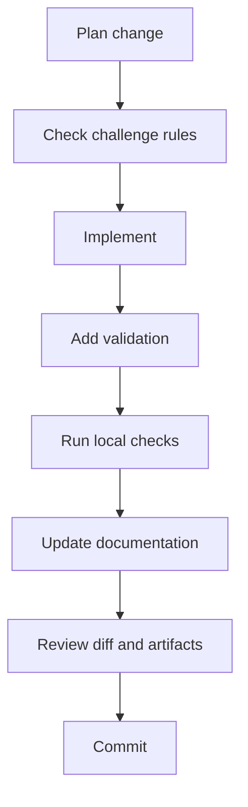

# 🧑‍💻 Development

Keep raw data unchanged, use repository-relative paths, fix random seeds, extract shared feature functions into `src/`, and store large artifacts outside Git. Follow the no-external-price-lookup rule.



Basic syntax check:

```bash
python -m compileall -q src sample_code.py
```

For notebook updates, validate notebook JSON and execute changed cells in a clean kernel. Full model training is not part of docs CI. Do not add checkpoints, bytecode, caches, image downloads, or generated feature matrices to Git.
