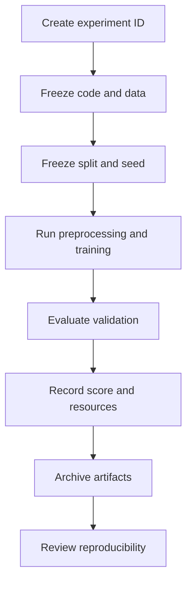

# 🧾 Experiment tracking

## 🎯 Purpose
A model score is meaningful only when the code, data, split, features, and metric implementation can be identified. Use this guide to make runs comparable.

## 📋 Required metadata
Record:
- Experiment ID and timestamp.
- Git commit and dataset checksums.
- Python, package, operating system, and hardware versions.
- Split strategy, random seed, and fold identifiers.
- Text cleaning, tokenizer, feature extraction, and numeric parsing configuration.
- Model family, parameters, callbacks, and target transformation.
- Metric implementation, validation SMAPE, runtime, and peak memory.
- Output artifact paths and checksums.
- Errors, warnings, and unresolved limitations.

## 🔄 Workflow

## 🚫 Avoid
- Comparing scores from different splits without qualification.
- Recording a training score as validation performance.
- Selecting hyperparameters against the hidden test set.
- Reporting a score from a failed or partially executed notebook.
- Overwriting previous run records without preserving history.

Use the root [EXPERIMENTS.md](../EXPERIMENTS.md) as the run register.
