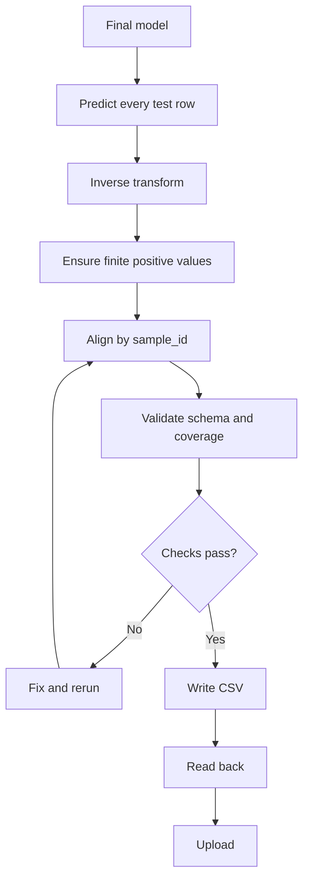

# 📤 Submission guide

## 📄 Required schema
```csv
sample_id,price
```
Every test ID must appear exactly once with a finite, strictly positive numeric price. Use the challenge sample output and latest portal instructions as formatting authority.

## ✅ Pre-upload checklist
- [ ] Exactly two columns, `sample_id` and `price`, in order.
- [ ] Row count exactly matches test input.
- [ ] Every test ID appears once, with no extras.
- [ ] No null IDs or duplicate IDs.
- [ ] Prices are finite numeric values and greater than zero.
- [ ] Any target transform was inverted correctly.
- [ ] CSV has been read back and checked.
- [ ] Methodology description matches the actual model.
- [ ] No prohibited external price lookup was used.

## 🧪 Example validator
```python
import numpy as np
import pandas as pd

test = pd.read_csv("dataset/test.csv")
submission = pd.read_csv("test_out.csv")
if list(submission.columns) != ["sample_id", "price"]:
    raise ValueError("Unexpected columns")
if len(submission) != len(test):
    raise ValueError("Wrong row count")
if submission["sample_id"].isna().any() or submission["sample_id"].duplicated().any():
    raise ValueError("Missing or duplicate IDs")
if set(submission["sample_id"]) != set(test["sample_id"]):
    raise ValueError("ID coverage mismatch")
prices = pd.to_numeric(submission["price"], errors="coerce")
if not np.isfinite(prices).all() or (prices <= 0).any():
    raise ValueError("Predictions must be finite and positive")
```

## 🔄 Export flow


`sample_code.py` is a random output-format demo, not a trained solution.
