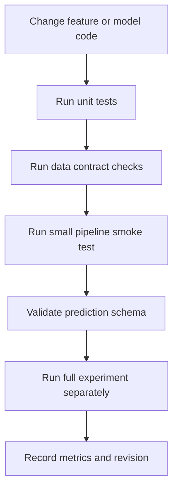

# 🧪 Testing strategy

## 📌 Current test status
The repository does not currently contain a dedicated automated unit-test suite for feature parsing, model training, SMAPE, or submission generation. The documentation workflow performs static integrity checks, validates notebook JSON, and compiles Python source. It does not train a model or prove model quality.

## 🔬 Recommended test layers

### 1. Unit tests
Add tests for:
- Quantity extraction with pack counts, decimals, years, model numbers, missing values, and ambiguous strings.
- Mass and volume parsing, including unit conversions and compound packages.
- Text normalization for Unicode, punctuation, empty strings, and null values.
- SMAPE behavior for ordinary values and zero-denominator cases.
- Submission schema, ID coverage, duplicates, NaN, infinity, zero, and negative predictions.

### 2. Data contract tests
- Required columns exist in train and test.
- Training target exists and is numeric.
- IDs are non-null and unique where required.
- Train and test identifiers do not overlap unexpectedly.
- Feature transforms preserve row count and row order.
- The prediction count equals the test row count.

### 3. Notebook checks
- Notebook JSON parses.
- Paths are repository-relative.
- A clean-kernel run is performed before publishing results.
- Failed cells and stale outputs are removed or clearly annotated.
- Expensive training is kept out of routine documentation CI.

### 4. Integration checks
Run the full preprocessing-to-prediction pipeline on a small permitted sample, then validate the generated CSV. Keep this sample separate from hidden test labels.

## 🔄 Test lifecycle

## 🚦 Release rule
Never treat successful syntax checks as proof of model correctness. Report exactly which checks ran and which expensive or data-dependent tests were not run.
